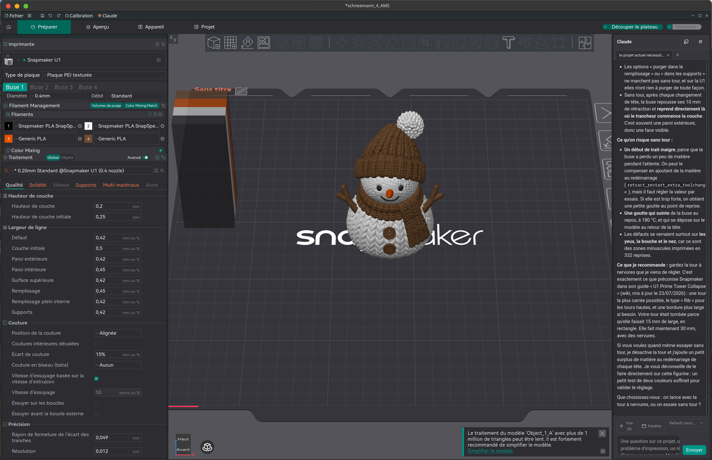

<h1> <p "font-size:200px;"> Snapmaker Orca</p> </h1>

[](https://github.com/Snapmaker/OrcaSlicer/actions/workflows/build_all.yml)
<br>Snapmaker Orca is an open source slicer for FDM printers based on OrcaSlicer.
 
# This fork: an AI assistant inside the slicer

This is an unofficial fork of [Snapmaker/OrcaSlicer](https://github.com/Snapmaker/OrcaSlicer). It adds an AI
assistant that can see your project and your printer and work in the slicer with you. It explains what it
finds and suggests what to do. Nothing changes until you confirm it in the slicer, and you can undo every change.



*Claude docked to the right of the 3D view. In this four-colour Snapmaker U1 project, it has just made the
prime tower wider and changed its type to Rib. It explains what could go wrong without the tower and cites
Snapmaker's wiki page on the subject.*

### What it adds

- **Chat with Claude in the slicer**: click the *Claude* button in the top bar. The chat can float or dock
  next to the 3D view. Each tab holds one conversation, and tabs are kept when you restart. One click attaches
  a capture of the 3D view or of the whole window. You can choose the Claude model.
- **Diagnose and fix**: the assistant reads the slicer's errors and warnings, explains them and proposes
  settings. When it helps, it checks Snapmaker's own wiki and support site and cites the page and its date, so
  you can see where a recommendation comes from. A dialog shows each proposed value next to the current one and
  the reason for the change. You choose which ones to apply.
- **Works like the Prepare tab**: it can scale, rotate, cut, split, arrange and orient objects, add
  modifiers and support blockers, and paint supports. It also handles plates, presets and filament slots,
  height ranges, pauses and colour changes at a given layer. It can leave chosen objects or the prime tower
  out of a print. One confirmation applies a change, and Ctrl+Z undoes it.
- **Slices and checks the result**: it slices one plate or all of them and reads the summary. It can look at
  the sliced preview and create calibration projects.
- **Knows your printer**: it reads the status of the connected printer and takes photos with its camera. It
  can watch a print, start, pause or cancel one, and unload filament. When only one printer is online, the
  slicer connects to it at startup.
- **Adapts downloaded projects**: when a 3MF was made for another printer (from MakerWorld, for example), the
  assistant switches it to the connected printer and nozzle. On the U1, it moves each filament to the
  toolhead that holds the closest material and colour.
- **Remembers and documents**: you can write instructions that the assistant reads at the start of every
  conversation. It also keeps a folder of Markdown notes and a log of past prints and their results. The
  documentation of every setting ships with the slicer, so it can explain any option without going online.
- **Open to other MCP clients**: the assistant uses an MCP server built into the slicer, so Claude Code,
  Gemini CLI or Claude Desktop can use it too (*Help → AI Assistant (MCP server)*). The server listens only
  on the local machine and needs a token to accept a request.

The chat needs [Claude Code](https://claude.com/claude-code) installed, with one login done in a terminal.

📥 **[Download the fork's pre-releases](https://github.com/oliiivier/OrcaSlicer/releases)**: Linux AppImage,
Arch Linux package and Windows installer. The builds are not signed, and neither Snapmaker nor Anthropic
distributes them. [FORK.md](FORK.md) describes the fork in detail: its tools, its security and
how it follows upstream.


# Download

### Stable Release
📥 **[Download the Latest Stable Release](https://github.com/Snapmaker/OrcaSlicer/releases/latest)**  
Visit our GitHub Releases page for the latest stable version of Snapmaker Slicer, recommended for most users.

# How to install
**Windows**: 
1.  Download the installer for your preferred version from the [releases page](https://github.com/Snapmaker/OrcaSlicer/releases).
    - *For convenience there is also a portable build available.*
    - *If you have troubles to run the build, you might need to install following runtimes:*
      - [MicrosoftEdgeWebView2RuntimeInstallerX64](https://github.com/SoftFever/OrcaSlicer/releases/download/v1.0.10-sf2/MicrosoftEdgeWebView2RuntimeInstallerX64.exe)
          - [Details of this runtime](https://aka.ms/webview2)
          - [Alternative Download Link Hosted by Microsoft](https://go.microsoft.com/fwlink/p/?LinkId=2124703)
      - [vcredist2019_x64](https://github.com/SoftFever/OrcaSlicer/releases/download/v1.0.10-sf2/vcredist2019_x64.exe)
          -  [Alternative Download Link Hosted by Microsoft](https://aka.ms/vs/17/release/vc_redist.x64.exe)
          -  This file may already be available on your computer if you've installed visual studio.  Check the following location: `%VCINSTALLDIR%Redist\MSVC\v142`

**Mac**:
1. Download the DMG for your computer: `arm64` version for Apple Silicon and `x86_64` for Intel CPU.  
2. Drag Snapmaker_Orca.app to Application folder. 
3. *If you want to run a build from a PR, you also need to follow the instructions below:*  
    <details quarantine>
    - Option 1 (You only need to do this once. After that the app can be opened normally.):
      - Step 1: Hold _cmd_ and right click the app, from the context menu choose **Open**.
      - Step 2: A warning window will pop up, click _Open_  
      
    - Option 2:  
      Execute this command in terminal: `xattr -dr com.apple.quarantine /Applications/Snapmaker_Orca.app`
      ```console
          softfever@mac:~$ xattr -dr com.apple.quarantine /Applications/Snapmaker_Orca.app
      ```
    - Option 3:  
        - Step 1: open the app, a warning window will pop up  
              
        - Step 2: in `System Settings` -> `Privacy & Security`, click `Open Anyway`:  
              
    </details>
    
**Linux (Ubuntu)**:
 1. If you run into trouble executing it, try this command in the terminal:  
    `chmod +x /path_to_appimage/Snapmaker_Orca_Linux.AppImage`
    
# How to compile
- Windows 64-bit  
  - Tools needed: Visual Studio 2019, Cmake, git, git-lfs, Strawberry Perl.
      - You will require cmake version 3.14 or later, which is available [on their website](https://cmake.org/download/).
      - Strawberry Perl is [available on their GitHub repository](https://github.com/StrawberryPerl/Perl-Dist-Strawberry/releases/).
  - Run `build_release.bat` in `x64 Native Tools Command Prompt for VS 2019`
  - Note: Don't forget to run `git lfs pull` after cloning the repository to download tools on Windows

- Mac 64-bit  
  - Tools needed: Xcode, Cmake, git, gettext, libtool, automake, autoconf, texinfo
      - You can install most of them by running `brew install cmake gettext libtool automake autoconf texinfo`
  - run `build_release_macos.sh`
  - To build and debug in Xcode:
      - run `Xcode.app`
      - open ``build_`arch`/Snapmaker_Orca.Xcodeproj``
      - menu bar: Product => Scheme => Snapmaker_Orca
      - menu bar: Product => Scheme => Edit Scheme...
          - Run => Info tab => Build Configuration: `RelWithDebInfo`
          - Run => Options tab => Document Versions: uncheck `Allow debugging when browsing versions`
      - menu bar: Product => Run

- Ubuntu 
  - Dependencies **Will be auto-installed with the shell script**: `libmspack-dev libgstreamerd-3-dev libsecret-1-dev libwebkit2gtk-4.0-dev libosmesa6-dev libssl-dev libcurl4-openssl-dev eglexternalplatform-dev libudev-dev libdbus-1-dev extra-cmake-modules libgtk2.0-dev libglew-dev libudev-dev libdbus-1-dev cmake git texinfo`
  - run 'sudo ./BuildLinux.sh -u'
  - run './BuildLinux.sh -dsir'


# Note: 
If you're running Klipper, it's recommended to add the following configuration to your `printer.cfg` file.
```
# Enable object exclusion
[exclude_object]

# Enable arcs support
[gcode_arcs]
resolution: 0.1
```


## Some background
Snapmaker Orca is originally forked from Snapmaker_Orca.

Snapmaker_Orca is originally forked from Bambu Studio, it was previously known as BambuStudio-SoftFever.
Bambu Studio is forked from [PrusaSlicer](https://github.com/prusa3d/PrusaSlicer) by Prusa Research, which is from [Slic3r](https://github.com/Slic3r/Slic3r) by Alessandro Ranellucci and the RepRap community. 
Orca Slicer incorporates a lot of features from SuperSlicer by @supermerill
Orca Slicer's logo is designed by community member Justin Levine(@freejstnalxndr)  


# License
Snapmaker Orca is licensed under the GNU Affero General Public License, version 3. Snapmaker_Orca is based on Orca Slicer by SoftFever

Orca Slicer is licensed under the GNU Affero General Public License, version 3. Orca Slicer is based on Bambu Studio by BambuLab.

Bambu Studio is licensed under the GNU Affero General Public License, version 3. Bambu Studio is based on PrusaSlicer by PrusaResearch.

PrusaSlicer is licensed under the GNU Affero General Public License, version 3. PrusaSlicer is owned by Prusa Research. PrusaSlicer is originally based on Slic3r by Alessandro Ranellucci.

Slic3r is licensed under the GNU Affero General Public License, version 3. Slic3r was created by Alessandro Ranellucci with the help of many other contributors.

The GNU Affero General Public License, version 3 ensures that if you use any part of this software in any way (even behind a web server), your software must be released under the same license.

Orca Slicer includes a pressure advance calibration pattern test adapted from Andrew Ellis' generator, which is licensed under GNU General Public License, version 3. Ellis' generator is itself adapted from a generator developed by Sineos for Marlin, which is licensed under GNU General Public License, version 3.

The Bambu networking plugin is based on non-free libraries from BambuLab. It is optional to the Orca Slicer and provides extended functionalities for Bambulab printer users.

# Feedback & Contribution
We greatly value feedback and contributions from our users. Your feedback will help us to further develop Snapmaker Orca for our community.
- To submit a bug or feature request, file an issue in GitHub Issues or email us at support@snapmaker.com.
- To contribute some code, make sure you have read and followed our guidelines for contributing.
